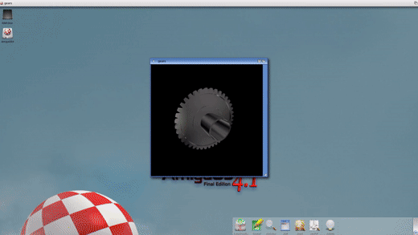
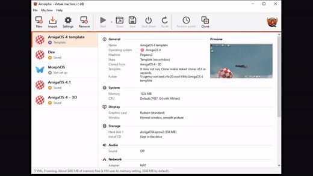
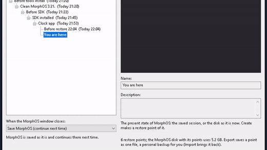

# Amorphix

Run MorphOS and AmigaOS 4 on your PC. Amorphix is a VirtualBox-style manager around an
optimized PowerPC emulator: create a machine, point it at your own install media, and reach
the desktop in minutes.

## Download

[Download Amorphix 1.0 for Windows](../../releases/latest)

A Linux build is on the same releases page.

## Quick start

1. Install Amorphix and open it.
2. New: pick MorphOS or AmigaOS 4, set RAM and a disk.
3. Insert your MorphOS CD image, or let AmigaOS 4 auto-install from your CD.
4. Boot.

## Features

- Manager: create, clone, import, export and template machines, with restore points.
- Per-VM settings: CPU, memory, media and networking.
- AmigaOS 4 auto-install: hand it your CD and it sets the system up, Guest Tools and bridge included.
- Guest Tools: a shared folder between your PC and the guest, plus clipboard and clock sync.
- Media: a second and third hard disk, CD images, and a Windows folder as a USB stick.
- 3D acceleration: OpenGL and MiniGL inside the guest.
- Dark mode, port forwarding, full screen, and a clean installer.

## Demos

Hardware 3D:

The VM manager:

AmigaOS 4:

Restore points:

Faster windows and disk:

Shared folder:

## You bring the OS

You must supply your own licensed copy of MorphOS and/or AmigaOS 4. Amorphix ships no
operating system files. See [getting a license](https://www.morphos-team.net/).

## Built on QEMU

Amorphix stands on QEMU, the open-source machine emulator.

## License

Amorphix is free software under the GNU General Public License v2.0. The complete source
accompanies each release.

---

Amorphix is an independent project. MorphOS is a trademark of the MorphOS Development Team.
AmigaOS is a trademark of Hyperion Entertainment. Amorphix is not affiliated with either.
