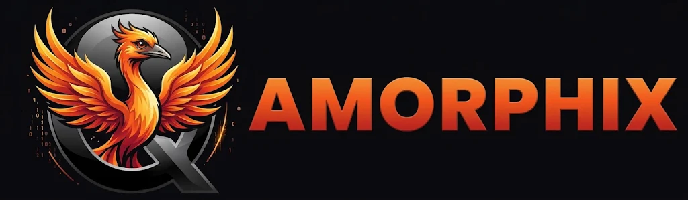
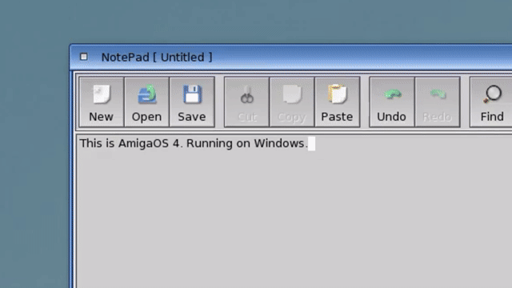
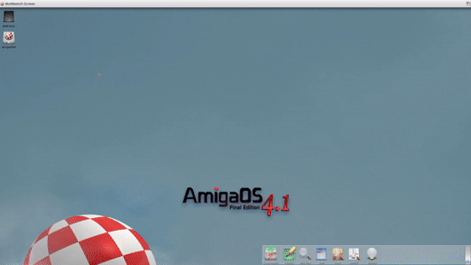
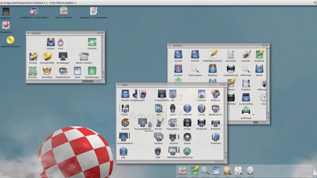
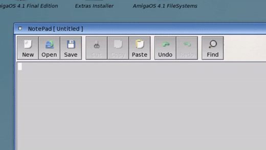

  

Run MorphOS and AmigaOS 4 on your PC. Amorphix is a VirtualBox-style manager around an
optimized PowerPC emulator.

## Benchmarks

Measured on AmigaOS 4, before and after Amorphix's accelerated defaults (the Amorphix GPU
for 3D, SFS for the disk).

3D, frames per second:

| Test | Before | Now | Gain |
|---|---|---|---|
| Cube | 276 | 417 | 1.5× |
| Cube, 1920x1080 | 59 | 108 | 1.8× |
| Gears | 31 | 91 | 2.9× |

Windows and disk:

| Test | Before | Now | Gain |
|---|---|---|---|
| Window resize, per second | 19-25 | 29-32 | |
| Scrolling, lines per second | 600-900 | 1235-1315 | |
| Copy 1527 small files | 24.8 s (FFS) | 3.9 s (SFS) | 6× |

## Download

[Download Amorphix 1.0 for Windows](../../releases/latest)

A Linux build is on the same releases page.

## Quick start

1. Install Amorphix and open it.
2. New: pick MorphOS or AmigaOS 4, set RAM and a disk.
3. Insert your MorphOS CD image, or let AmigaOS 4 auto-install from your CD.
4. Boot.

## Features

- Manager: create, clone, import, export and template machines, with restore points.
- Per-VM settings: CPU, memory, media and networking.
- AmigaOS 4 auto-install: hand it your CD and it sets the system up, Guest Tools and bridge included.
- Guest Tools: a shared folder between your PC and the guest, plus clipboard and clock sync.
- Media: a second and third hard disk, CD images, and a Windows folder as a USB stick.
- 3D acceleration: OpenGL and MiniGL inside the guest.
- Dark mode, port forwarding, full screen, and a clean installer.

## Demos

Hardware 3D:

The VM manager:

AmigaOS 4:

Restore points:

Faster windows and disk:

Shared folder:

## You bring the OS

You must supply your own licensed copy of MorphOS and/or AmigaOS 4. Amorphix ships no
operating system files. See [getting a license](https://www.morphos-team.net/).

## Built on QEMU

Amorphix stands on QEMU, the open-source machine emulator.

## Trademarks

AmigaOS is a trademark of Amiga Corporation. MorphOS is a trademark of the MorphOS Development Team. Amorphix is an independent project and is not affiliated with or endorsed by them. You need your own licensed copy of each OS.

## License

Amorphix's manager, installer and Guest Tools are proprietary (see the licence in the app).

The open-source parts keep their own licences: QEMU with our changes (GPL v2), FFmpeg
(LGPL), BBoot, OpenBIOS and the GPL part of the AmigaOS 4 Warp3D driver. Their source is
included in the installer's `source` folder; for Linux it is the separate source tarball on
the [releases page](https://github.com/BartT21/Amorphix/releases).
